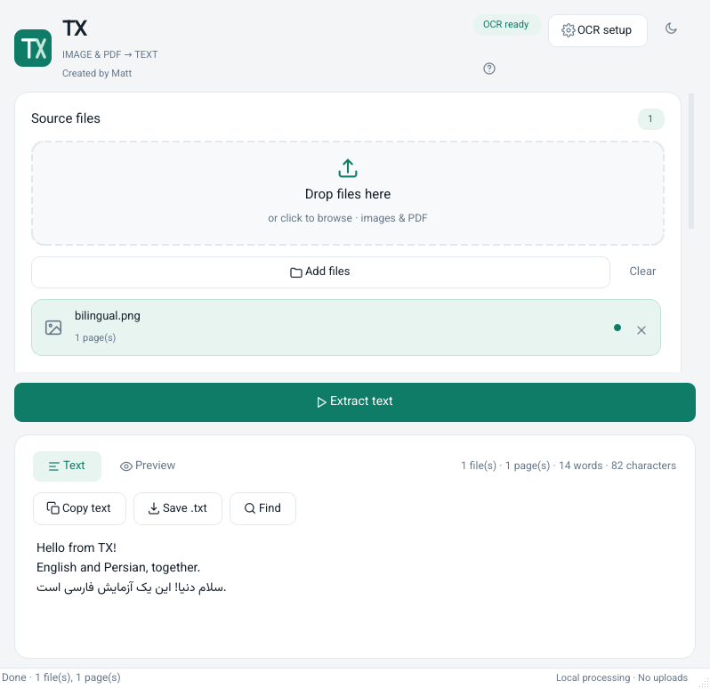

# TX

A local, modern desktop app that extracts **English and Persian** text from images and PDFs.
Version 1.2.4 makes multi-file preview switchable with a file chooser and previous/next file buttons. Version 1.2.3 fixes a Windows theme-toggle crash after preview navigation and reduces frameless-dialog geometry warnings. Version 1.2.2 removes the remaining dark background behind the left-hand cards, removes the native shadow around the OCR setup/About dialogs, and fixes clipped OCR-setup status text. Version 1.2.0 added a bundled layout-aware OCR engine for Persian advertisements and mixed designs, plus a responsive window layout.

Persian documentation: [`docs/راهنمای-فارسی.html`](docs/راهنمای-فارسی.html)



## Features

- Drag & drop images and PDFs, or browse for files.
- **Auto OCR**: bundled RapidOCR / ONNX Runtime models for posters, multi-column artwork, and mixed Persian/English; optional Tesseract for clean scans.
- Smart PDF handling: use the existing text layer when possible, OCR scanned pages, and merge mixed pages.
- RTL-aware text display; Persian word spacing, half-spaces, and Persian numerals are preserved/repaired conservatively.
- Copy, search, preview pages, and save UTF-8 `.txt`.
- Responsive layout: side-by-side on wide windows, stacked/scrollable on narrow windows; wrapping toolbars.
- Light/dark theme, progress, cancellation, and per-file error reporting.
- Password-protected PDFs; passwords are kept only for the current session.
- CLI mode and offscreen GUI/responsive smoke tests.

## Quick start

Python 3.10+ is required. The Persian/English OCR models are bundled in `tx/assets/models`; no model download is needed for the default engine.

```bash
python -m venv .venv
# Windows: .venv\Scripts\activate
source .venv/bin/activate
python -m pip install -r requirements.txt
python app.py
```

Tesseract is **optional**. Auto mode uses it when available to improve clean scans and recover digits; RapidOCR handles complex layouts. To use Tesseract, install it and the English/Persian packs:

- **Windows:** install Tesseract, then point OCR setup to `tesseract.exe` if it is not found automatically.
- **macOS:** `brew install tesseract`
- **Debian/Ubuntu:** `sudo apt install tesseract-ocr tesseract-ocr-eng tesseract-ocr-fas tesseract-ocr-osd`

Language packs can also be installed with:

```bash
python scripts/install_languages.py
```

## CLI

```bash
python app.py scan.png -o text.txt
python app.py poster.jpg --engine rapid -o poster.txt
python app.py book.pdf --lang eng+fas --dpi 300 -o book.txt
python app.py *.jpg --json > result.json
python app.py --doctor
```

## Supported inputs

PDF and common Pillow-supported raster formats: PNG, JPEG, TIFF, BMP, WebP, GIF, HEIC/HEIF, AVIF, JPEG 2000, ICO, PSD, TGA, PCX, PPM/PGM/PNM, QOI, and more. Multi-page TIFF and animated images are processed frame by frame, up to a safety limit.

SVG, EPS/PS, and camera RAW files are not supported directly; export them to PNG/JPEG/TIFF/PDF first.

## Tests

```bash
python -m pip install -r requirements-dev.txt
python -m pytest -q
python scripts/smoke_gui.py
python scripts/smoke_responsive.py
```

OCR tests are skipped automatically when the corresponding engine is unavailable. The advertisement regression uses a **synthetic representative fixture**, not a user-supplied original; it checks Persian/English spacing, numerals, and layout recovery.

## Build a desktop executable

```bash
python -m pip install pyinstaller
pyinstaller tx.spec
```

The bundled RapidOCR models are included. Tesseract remains an external dependency unless you bundle it yourself.

## License

TX code: MIT, created by Matt. Bundled fonts/models and third-party components have their own licenses; see `THIRD_PARTY_NOTICES.md` and `tx/assets/models/`.
#
